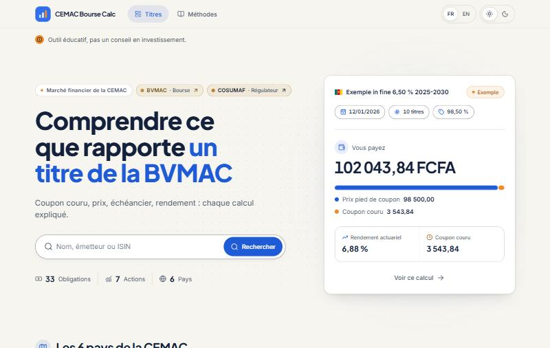
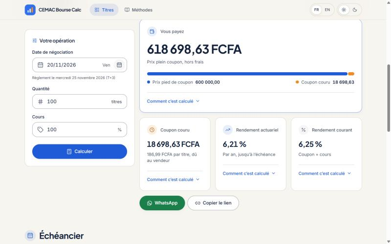
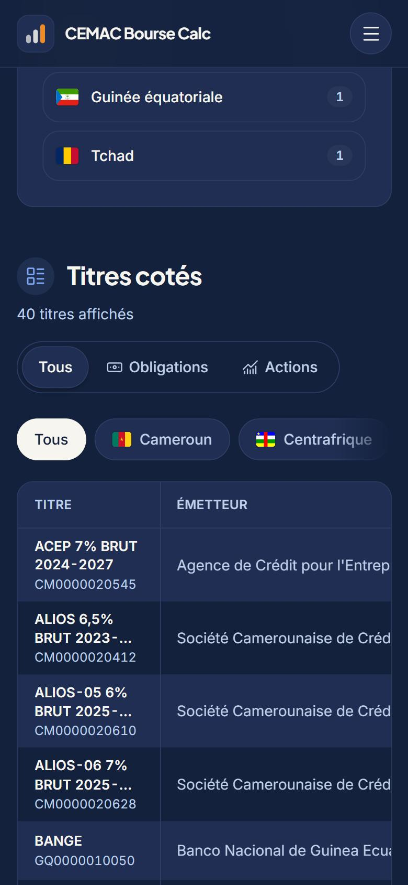
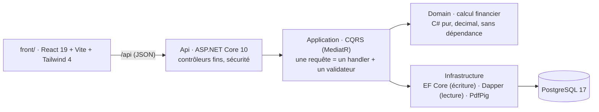

# CEMAC Bourse Calc

**Comprendre ce que rapporte vraiment un titre coté à la BVMAC, avant de l'acheter.**

Coupon couru, prix plein coupon, échéancier des coupons et des remboursements, rendement actuariel,
rendement du dividende : chaque calcul est fait au centime, expliqué pas à pas, et **comparé
automatiquement aux chiffres publiés par la Bourse des valeurs mobilières de l'Afrique centrale**.

    

> Outil éducatif et indépendant. Ce n'est pas un conseil en investissement ; les ordres se passent
> auprès d'une société de bourse agréée par la COSUMAF.

| Accueil | Calculateur d'une obligation | Mobile, thème sombre |
|---|---|---|
|  |  |  |

---

## Pourquoi

De plus en plus d'épargnants de la CEMAC achètent des emprunts d'État (Cameroun, Gabon, Congo, Tchad…)
et des actions cotées. Mais les questions les plus simples restent sans réponse claire :

- *Pourquoi est-ce que je paie plus que le cours affiché ?* Parce qu'il faut ajouter le coupon couru.
- *Combien vais-je toucher, et quand ?* Cela dépend de l'échéancier, du différé et de l'amortissement.
- *Quel est le vrai rendement, au cours d'aujourd'hui ?*

Les réponses existent, mais elles sont réparties dans un PDF de 27 pages publié chaque soir (le bulletin
officiel de la cote) et dans des prospectus. CEMAC Bourse Calc les rassemble, les calcule et les explique.

**Pour qui ?**
- **Les épargnants :** comprendre avant d'acheter, puis vérifier l'avis d'opéré reçu de sa société de bourse.
- **Les professionnels :** un outil de contrôle indépendant pour les équipes de règlement et de back-office.
- **Le marché :** rendre la cote lisible, et donc plus attractive.

## Des chiffres vérifiés contre la BVMAC, pas des chiffres d'exemple

Les données sont celles du **bulletin officiel de la cote n° 2643 du 20/11/2026** : 33 obligations,
7 actions, 14 émetteurs, chaque ligne reliée à sa page d'origine ([donnees/bvmac](donnees/bvmac/2026-11-20_BOC-2643/LISEZMOI.md)).

À chaque exécution des tests, le calcul est confronté à la publication officielle :

| Contrôle | Résultat |
|---|---|
| Coupon couru au règlement J+3, recalculé pour chaque obligation | **33 / 33 identiques au centime** |
| Échéanciers (capital et intérêts) face aux fiches des émetteurs | identiques à moins d'1 FCFA ; 4 écarts expliqués et documentés |
| Lecture automatique du PDF du bulletin | les 40 cours redonnés au centime ; 4 bulletins lus sans erreur |

Les écarts restants ne sont pas cachés. Ils sont listés avec leur cause (arrondi de la part
d'amortissement, fiche ALIOS calculée en Exact/360). Un test échoue s'ils disparaissent, pour qu'on
les retire de la liste.

## Ce que fait l'application

### Site public
- **Les 40 titres cotés**, avec recherche, filtres par type et par pays, une carte des 6 pays et une pagination.
- **Fiche obligation :** caractéristiques, puis le calculateur. On saisit une date, une quantité et un cours, et on obtient :
  - le coupon couru, avec le décompte des jours ;
  - le prix plein coupon ;
  - le rendement actuariel et le rendement courant ;
  - l'échéancier complet, avec son graphique.
- **Fiche action :** le dernier cours, les dividendes et le rendement du dividende.
- **Historique des cours, sur chaque fiche :** la courbe des cours de clôture avec les volumes, sur 1 mois, 3 mois, 6 mois, 1 an ou tout l'historique ; le plus haut, le plus bas, la variation sur la période, et le tableau des séances. Survol à la souris, au doigt ou au clavier.
- **Méthodes :** chaque formule expliquée avec un exemple chiffré, et un lien « Comment c'est calculé » sous chaque résultat.
- **Utilisable par tous :** français et anglais, thème clair et sombre, parfait dès 360 px de large, accessible au clavier et aux lecteurs d'écran.

### Administration (`/admin`)
- **Six rubriques :** obligations, actions, cours, dividendes, émetteurs, jours non ouvrés. Chacune a une liste paginée par le serveur, une saisie à l'unité et un import de fichier (Excel ou CSV), avec des modèles à télécharger.
- **Import du bulletin de la cote (PDF) en un geste :**
  1. l'API lit le PDF ;
  2. elle rapproche chaque titre de la base ;
  3. elle compare chaque coupon couru publié au calcul ;
  4. elle affiche un aperçu, puis l'administrateur valide.

  La saisie quotidienne des cours passe ainsi de 40 lignes à un seul dépôt de fichier.
- **Tout ou rien :** s'il reste une seule ligne à corriger, rien n'est enregistré. La saisie à l'unité et l'import suivent exactement les mêmes règles.

## Le calcul, en bref

| Notion | Règle appliquée (vérifiée sur le bulletin) |
|---|---|
| Coupon couru | nominal restant × taux × jours ÷ base, depuis la dernière date de coupon jusqu'au **règlement à J+3 jours ouvrés** |
| Conventions de décompte | Exact/365, Exact/360, 30E/360 : une classe par convention, portée par chaque titre |
| Amortissement | in fine ou constant, avec différé d'échéances ; périodicité annuelle, semestrielle, trimestrielle ou mensuelle |
| Jours ouvrés | week-ends et jours fériés de la place ; paiement reporté au jour ouvré suivant |
| Rendement actuariel | taux qui égalise le prix plein coupon et les flux futurs (résolution numérique) |

Tout est calculé en `decimal`, jamais en virgule flottante, dans une couche Domain en C# pur, sans dépendance externe.

## Architecture



| Dossier | Rôle |
|---|---|
| `src/CemacBourseCalc.Domain` | Coupon couru, échéancier, rendements, conventions, jours ouvrés, ISIN (clé de Luhn, pays CEMAC) |
| `src/CemacBourseCalc.Application` | Commands et Queries, validation FluentValidation, lecture du bulletin (code pur, testé) |
| `src/CemacBourseCalc.Infrastructure` | Requêtes SQL paramétrées (Dapper), migrations EF Core, lecture PDF (PdfPig) |
| `src/CemacBourseCalc.Api` | Routes publiques et d'administration, session, limitation des requêtes |
| `front/` | Site public et administration (module chargé à part) |
| `tests/` | xUnit (Domain, Application) ; `node --test` pour le front |
| `donnees/bvmac/` | Données réelles du bulletin, prêtes à importer, et le PDF d'origine |
| `docs/` | Schéma des tables ([diagramme](docs/schema.md), [SQL](docs/schema.sql)) |
| `maquettes/` | Maquettes HTML validées avant chaque écran |

**Performances**
- Les listes sont paginées par la base : le total et la page arrivent en un seul aller-retour, 50 lignes au plus.
- Les colonnes filtrées sont indexées.
- Le contrôle du coupon couru coûte deux lectures par page.
- La lecture du PDF s'arrête dès que les tableaux de la séance sont lus (5 pages sur 27).

## Sécurité

- **Aucun secret dans le dépôt.** La chaîne de connexion vit dans les user-secrets, et les mots de passe sont saisis masqués.
- **Base au moindre privilège :** un compte pour l'API, propriétaire de sa base mais pas superutilisateur, et un compte en lecture seule.
- **Requêtes SQL toujours paramétrées.** La recherche est échappée et les filtres sont contrôlés sur liste blanche.
- **Session d'administration :**
  - cookie `HttpOnly`, `Secure`, `SameSite=Strict`, d'une durée de 8 heures ;
  - seule l'empreinte SHA-256 du jeton est gardée en base ;
  - mots de passe hachés en PBKDF2 ;
  - 5 essais de connexion par minute.
- **Protection CSRF :** toute écriture exige un en-tête dédié.
- **Limites :** nombre de requêtes par minute, taille des envois, 500 lignes par import, PDF de 10 Mo au plus gardé en mémoire seulement.
- **Traçabilité :** chaque création est inscrite au journal d'administration, dans la même transaction.

## Démarrer

Prérequis : .NET SDK 10, Node 22, PostgreSQL 16 ou plus.

1. **Base de données.** Créez la base et ses deux comptes ; les mots de passe sont demandés au clavier, masqués :

   ```bash
   psql -h localhost -p 5433 -U postgres -d postgres -f scripts/creer_base.sql
   ```

   Puis enregistrez la chaîne de connexion de l'API dans les user-secrets :

   ```powershell
   powershell -ExecutionPolicy Bypass -File scripts\configurer_secret.ps1
   ```

   (Sans `psql` : suivez `scripts/creer_base_dbvisualizer.sql`.)

2. **Migrations.**

   ```bash
   dotnet tool restore
   dotnet ef database update -p src/CemacBourseCalc.Infrastructure -s src/CemacBourseCalc.Api
   ```

3. **API, puis site.**

   ```bash
   dotnet run --project src/CemacBourseCalc.Api --launch-profile http
   ```

   ```bash
   cd front && npm install && npm run dev
   ```

   Pour voir le site sans API ni base, avec des données d'exemple : `cd front && npm run dev:exemple`.

4. **Premier compte d'administration.** Le mot de passe est demandé au clavier ; aucune route publique ne crée de compte.

   ```bash
   dotnet run --project src/CemacBourseCalc.Api -- creer-admin
   ```

5. **Données réelles.** Dans `/admin`, importez dans l'ordre les fichiers de [donnees/bvmac/2026-11-20_BOC-2643](donnees/bvmac/2026-11-20_BOC-2643/LISEZMOI.md) : émetteurs, obligations, actions, cours, dividendes. Ensuite, chaque séance s'ajoute en déposant le PDF du bulletin.

6. **Tests.**

   ```bash
   dotnet test
   ```

   ```bash
   cd front && npm test
   ```

## API

| Public | |
|---|---|
| `GET api/titres` · `GET api/titres/{id}` | liste et fiche des titres |
| `GET api/titres/{id}/cours` | historique des cours (environ cinq ans de séances, du plus ancien au plus récent) |
| `GET api/obligations/{id}/coupon-couru?dateNegociation&quantite&cours` | coupon couru et prix plein coupon |
| `GET api/obligations/{id}/echeancier` · `…/rendement` | échéancier, rendements |
| `GET api/actions/{id}/rendement-dividende?cours` | rendement du dividende |

L'administration (`api/admin/…`, session obligatoire) offre pour chaque rubrique trois routes :
`GET` (liste paginée), `POST` (création d'une ligne) et `POST …/masse` (import, tout ou rien). S'y ajoutent
`POST api/admin/bulletins/analyse` (aperçu du PDF du bulletin) et `GET api/admin/compteurs`.

## Feuille de route

- [x] Calcul : coupon couru, prix plein coupon, échéancier, rendements, conventions, jours ouvrés
- [x] Site public : titres, fiches, calculateur, méthodes ; FR/EN, clair/sombre, mobile
- [x] Données réelles du bulletin n° 2643 et comparaison automatique avec la BVMAC
- [x] Administration : listes paginées, saisie à l'unité, import de fichier
- [x] Import du bulletin de la cote (PDF) avec aperçu et contrôle des coupons courus
- [x] Historique des cours et graphiques d'évolution
- [ ] Téléchargement automatique du bulletin chaque soir (selon les conditions d'utilisation de la BVMAC)
- [ ] Portefeuille simulé (fictif, éducatif)
- [ ] Modification des titres avec journal ; calendrier officiel des jours fériés ; mise en ligne

## Sources

Les données viennent des publications officielles de la **BVMAC** (bulletins officiels de la cote,
fiches des émetteurs) et des prospectus visés par la **COSUMAF**, le régulateur du marché financier de
l'Afrique centrale. Elles restent la propriété de leurs auteurs. Ce projet n'est affilié ni à la BVMAC
ni à la COSUMAF.
