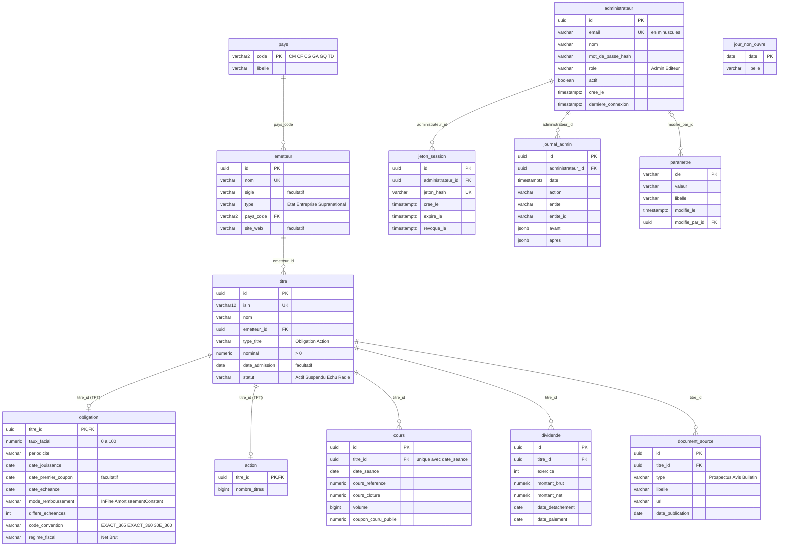

# Schéma de la base (13 tables)

Généré à partir de la migration `Initiale`. Le SQL exact est dans [schema.sql](schema.sql)
(régénérer : `dotnet ef migrations script -i -p src/CemacBourseCalc.Infrastructure -s src/CemacBourseCalc.Api -o docs/schema.sql`).

Le diagramme s'affiche sur GitHub, ou dans VS Code avec l'extension « Markdown Preview Mermaid Support ».

## Données initiales

- `pays` : les 6 pays de la CEMAC.
- `parametre` : `DELAI_REGLEMENT_JOURS_OUVRES` = 3 (T+3), `REGLE_REPORT_PAIEMENT` = `JOUR_OUVRE_SUIVANT`.
